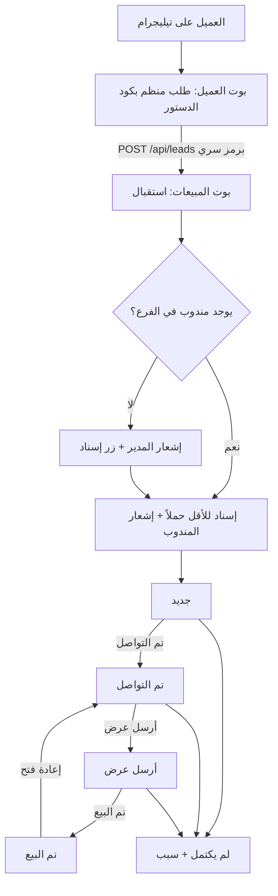
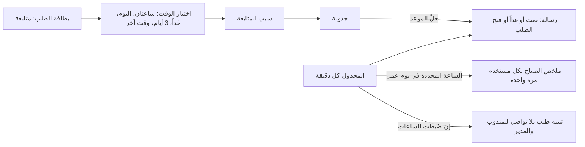
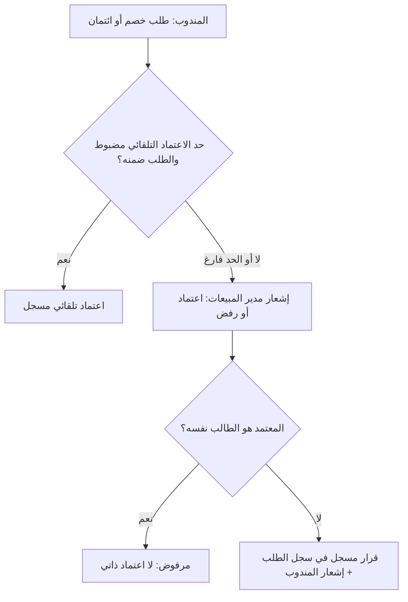
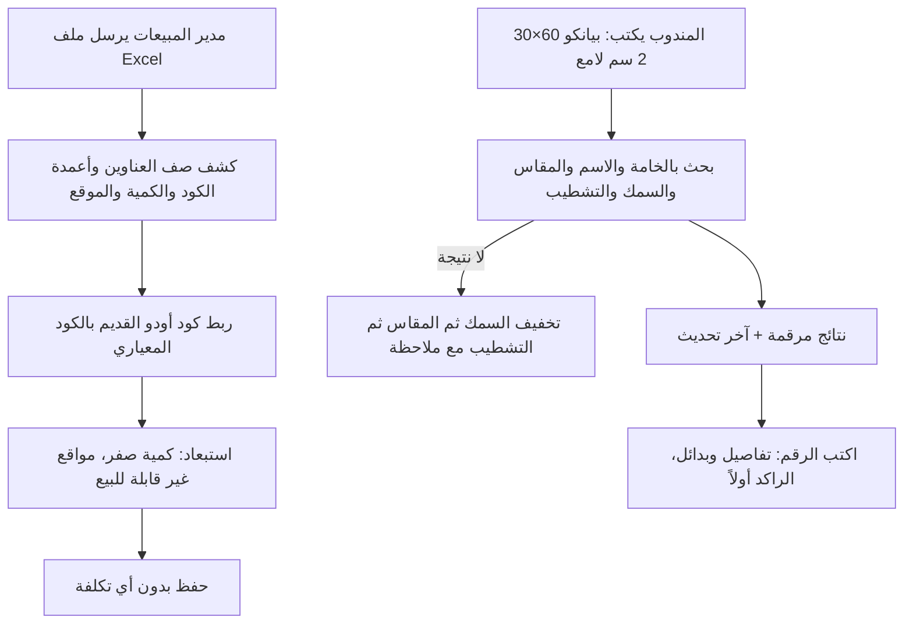

# خريطة التدفق

## رحلة الطلب

كل طلب يُستقبل مرة واحدة فقط (المفتاح `external_ref`)، وإعادة الإرسال لا تكرره.

## المتابعات وملخص الصباح

## الاعتمادات

## المخزون

## ما يكتبه المستخدم وما يحدث

| المدخل | النتيجة |
| --- | --- |
| اسم صنف أو مواصفات | بحث في المخزون |
| `#12` أو `طلب 12` | بطاقة الطلب 12 (إن كان له) |
| رقم جوال | ملف العميل |
| `قائمة` أو `/start` | القائمة الرئيسية |
| `إلغاء` | إيقاف الخطوة الحالية |
| `/myid` | معرّف تيليجرام الخاص بك (يعمل لغير المسجلين أيضاً) |
| ملف xlsx من المدير | استيراد المخزون، أو الراكد إن كان اسمه يحوي كلمة راكد |
